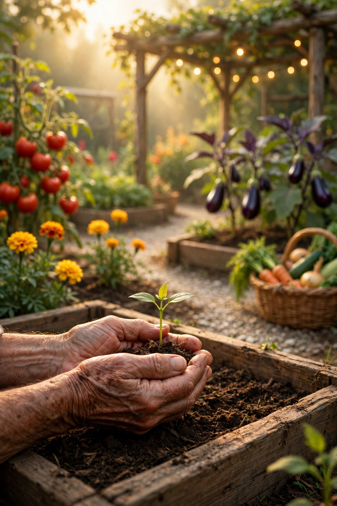
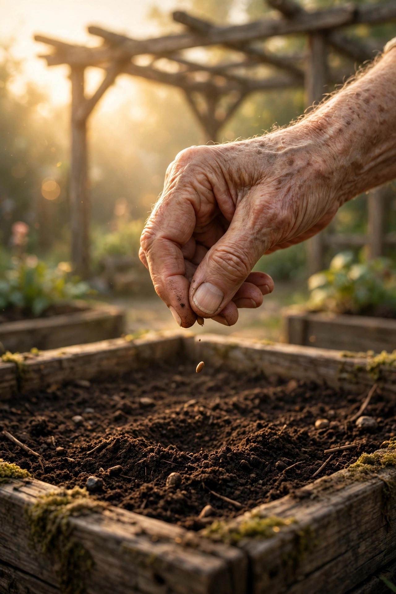
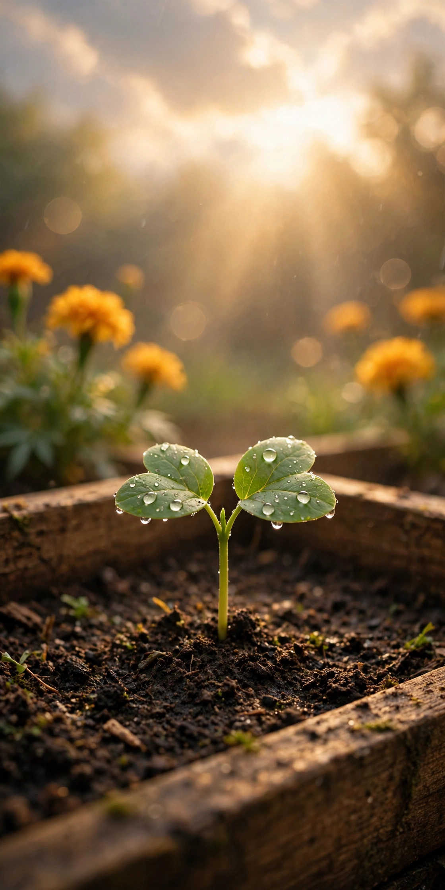
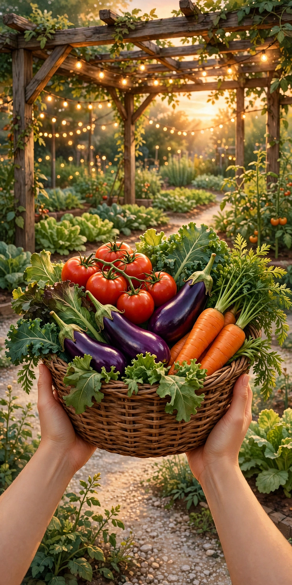

# The Seed That Waited 🌱

*A fable about patience, from Fable Mint. First published November 16, 2026.*

A gardener planted a tiny seed and waited.
Rain came. Sun came. Still, nothing.
Neighbours laughed. Nothing is growing.
But under the soil, roots were growing quietly.

Weeks later, a small green shoot appeared. Then leaves. Then tomatoes, brinjal, and flowers enough to share.

Good things do not rush. They grow quietly, then all at once.

If you are waiting for your season, keep watering. Your harvest is coming. 🌿

## Moral

Good things do not rush. They grow quietly, then all at once. Keep watering — your harvest is coming.

## The story in three pictures

The fable was also published as a three-picture carousel — seed, sprout, harvest:

## Published posts

- Single-image post: https://facebook.com/61595706291082/posts/pfbid02yhe8UXyZ7PrpWZNBwdER41S9foboeWcKh5ZS37UWxfm1MiVbqshUGDcNm5LZqVfel/
- Three-picture carousel: https://facebook.com/61595706291082/posts/pfbid0wZ2w2z14xArX9QAgJjPQzvuaLCK5jrDpJo3yMVqAGiSyE9i1irmG26qtrrC7b8zpl/

*#FableMint #TimelessStories #PatienceGrows*
